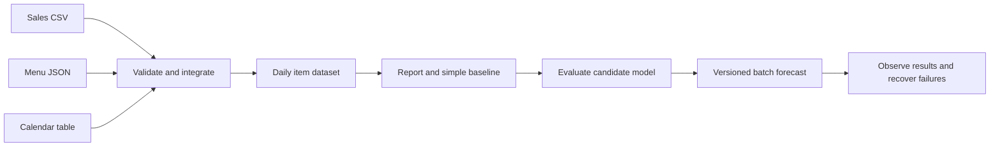

# Canteen project: from records to reliable predictions

**Level: Advanced** · Start with the Year 1 roadmap if these ideas are unfamiliar.

Audience: engineering students exploring software and data pathways
Status: Draft | Independent review pending
Last updated / sources checked: 12 November 2026

Project type: staged learning brief, not a runnable application
Prerequisites: programming and SQL basics; statistics before model evaluation
Cost scope: synthetic local files, a local database and optional local models; no paid AI or cloud service required

## Problem and boundaries

Estimate next-day demand for a small canteen. The learning goal is to connect data integration, model evaluation and operations. Use invented data with no customer names, payments or identifiers. Do not use this exercise to make real purchasing decisions without appropriate validation and oversight.

## Stage 1: define three sources

| Source | One row or record represents | Suggested fields |
| --- | --- | --- |
| Sales | One synthetic sale line | sale_id, date, item_id, quantity |
| Menu | One menu item | item_id, name, active_from |
| Calendar | One date | date, open_flag, event_known_in_advance |

State the date/time convention and integer constraints. For this first exercise, give each menu item one definition and document that limitation; historical price/name changes would need a more careful design. A missing sales file is different from an open day with zero recorded sales or a closed day.

Deliverable: data dictionary, small synthetic files and expected clean rows.

## Stage 2: integrate and validate

Load the sources into local tables. Validate required values, unknown item references and duplicate sale identifiers. Keep rejected records with reasons. Produce daily quantity by item for eligible open days.

Rerun the same import and confirm totals do not double. Explain how a corrected file would replace or update earlier information. Record row counts before and after joins to catch accidental multiplication.

Deliverable: transformation logic, reconciliation and a duplicate-safe rerun demonstration.

## Stage 3: report and establish a baseline

Plot or tabulate demand over time. Define a trailing-average forecast using only preceding eligible days; document the window and what happens when too little history is available. Do not use the day being predicted in its own average.

For a short worked check, suppose forecasts are 10 and 14, and later actual quantities are 12 and 11. Absolute errors are 2 and 3, so mean absolute error (MAE) is 2.5 units. These are invented numbers, not experimental results.

Deliverable: report, baseline rule and hand-checked metric.

## Stage 4: evaluate a candidate model

Create more synthetic history to practise mechanics. Use earlier dates for training, a subsequent validation period for choices and a final untouched test period. Avoid features only known after the forecast time. Compare the candidate and baseline on the same eligible dates.

Report MAE, period, sample count and exclusions. If the model performs worse, keep the baseline and explain the outcome. Synthetic evaluation does not establish performance on a real canteen.

Deliverable: reproducible evaluation and a short limitations note.

## Stage 5: add operational checks

Save model/baseline version, data version, feature definitions and environment details. Start with a batch forecast file; an API is optional. Define a release check and retain the last known working artifact.

| Failure to introduce | Expected behaviour to specify and demonstrate |
| --- | --- |
| Duplicate source file | No duplicated quantities |
| Unknown menu item | Quarantine or explicit failure, not a guessed mapping |
| Missing daily file | Flag stale/incomplete inputs rather than assume zero |
| New model fails evaluation | Retain previous accepted version |
| Inference failure | Explicit error or documented fallback with version/freshness |
| Outcomes arrive late | Track that quality metrics are pending |

Deliverable: failure-test record, release notes and a rollback demonstration. Do not claim these have been implemented until you run them.

## Optional generative-AI extension

Build a question-answering demo over invented, approved canteen policy documents. Keep it separate from the numerical forecaster. Record retrieved passages, test questions and unsupported-answer handling. Compare with simple document search. No external API or paid model is required for the core project; skip the extension if resources are limited.

## Portfolio package

Include problem, architecture diagram, data dictionary, own synthetic data, setup, tested versions, transformation/evaluation code, sample outputs, failures, limitations and your individual contribution. Follow the repository’s content/code licensing policy. The strongest explanation is how you discovered and corrected a mistake.

[Back to AI, Data and Career Pathways](index.md)
