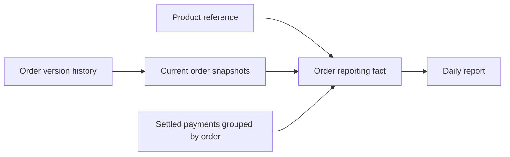

# Reporting Models and Reconciliation

**Level: Beginner, after versioned orders | Learning draft | Independent review pending**

Goal: turn retained source snapshots into a report with a clear grain and prove that totals reconcile. Allow two two-hour sessions. Prerequisites: [corrections and late data](corrections-and-late-data.md), joins and aggregation. This lesson uses the integrated workflow introduced below; earlier labs keep their own databases.

## Define the business measures

- **Ordered value:** quantity × captured unit price for the current version of each order.
- **Settled amount:** sum of the supplied settled payment records for an order. Pending payments are excluded.
- **Outstanding:** ordered value minus settled amount. A negative value signals overpayment to investigate, not an arithmetic failure.

These are teaching measures, not profit or formal revenue recognition. Refunds, tax, cancellation and payment corrections are outside this fixture.

## Choose grain before joining

| Model | One row represents | Key |
| --- | --- | --- |
| `order_versions` | One source version of an order | order ID + source version |
| `current_orders` view | Latest known snapshot of an order | order ID |
| `dim_products` | One current product label | product ID |
| `fact_orders` | One current order and its aggregated settled payments | order ID |
| `daily_report` | Orders grouped by business date | order date |

The dimension provides descriptive labels; the fact contains measurable values. This is a small teaching model, not a complete warehouse design. Product labels are refreshed from a reference file and have no historical dimension tracking. Do not join raw payment rows directly to order totals: aggregate the many-side first.



## Run the integrated example

Refresh your [starter ZIP](../../../downloads/canteen-starter.zip), extract into a new working folder, and run:

```text
python seed_source.py
python run_incremental.py
```

The first run **exits with code 2** because two source rows are quarantined; valid data and reports still commit. This is an intentional warning, not an unhandled crash. Run the commands separately. The integrated target is `warehouse.sqlite`; it does not alter `pipeline.sqlite` or `versions.sqlite` from earlier lessons.

## Expected report on the supplied fixture

| Business date | Orders | Ordered, paise | Settled, paise | Outstanding, paise |
| --- | --- | --- | --- | --- |
| 2026-11-01 | 3 | 13000 | 9000 | 4000 |
| 2026-11-02 | 3 | 20000 | 11000 | 9000 |
| Total | 6 | 33000 | 20000 | 13000 |

O4's corrected quantity increases ordered value while its settled payments remain unchanged. Late O6 belongs to November 1 and has no supplied payment. The input payment CSV is a **fixed synthetic lookup**, re-read when reporting refreshes. It is not a second incremental payment ingestion system, and it has no event-time/freshness tracking. Payments for orders not yet extracted are excluded until the order exists; intermediate batches are partial reports.

## Inspect the model

Save this as `inspect_report.py` and run from the folder containing `warehouse.sqlite`:

```python
import sqlite3
connection = sqlite3.connect('warehouse.sqlite')
try:
    print(connection.execute('SELECT * FROM daily_report ORDER BY order_date').fetchall())
    print(connection.execute(
        'SELECT p.product_name, SUM(f.ordered_paise) '
        'FROM fact_orders f JOIN dim_products p ON f.product_id=p.product_id '
        'GROUP BY p.product_id,p.product_name ORDER BY p.product_name'
    ).fetchall())
finally:
    connection.close()
```

Product ordered values should be Idli 10000, Meal 20000, Tea and snack 3000 paise. Explain why SUM over history would overstate current orders, and why distinct product names are not safe keys.

## Worked scenarios with answers

Read [Reporting scenarios: questions, answers and checks](reporting-worked-scenarios.md) for the complete session, including safe joins, missing payments, negative outstanding, mismatched totals and root-cause investigation. All answers are included, with executable SQL and an automated scenario check.

## Reconciliation and exercises

`reporting.py` checks current-order count/value against `fact_orders` and the aggregated daily report, then checks ordered = settled + outstanding per order. These checks catch some transformation errors; they do not establish that a source price is true or that all expected payments arrived.

1. Write a SQL query proving all three grand totals and the balance identity.
2. Predict outstanding if a settled payment is missing. Test in a working copy, then restore the original reference file.
3. Explain why a report can reconcile internally and still omit a missing source file.
4. Ask AI to propose a join that would inflate totals, explain the grain error and correct it yourself.

Expected evidence: model/key definitions, saved SQL and the six-order/33000-paise reconciliation. Implementation: `reporting.py`. [Python SQLite reference](https://docs.python.org/3/library/sqlite3.html) checked 13 November 2026.

Next: [Incremental extraction and checkpoints](incremental-extraction.md).
